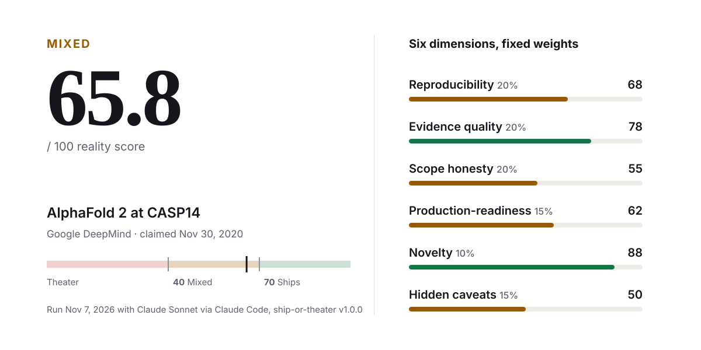
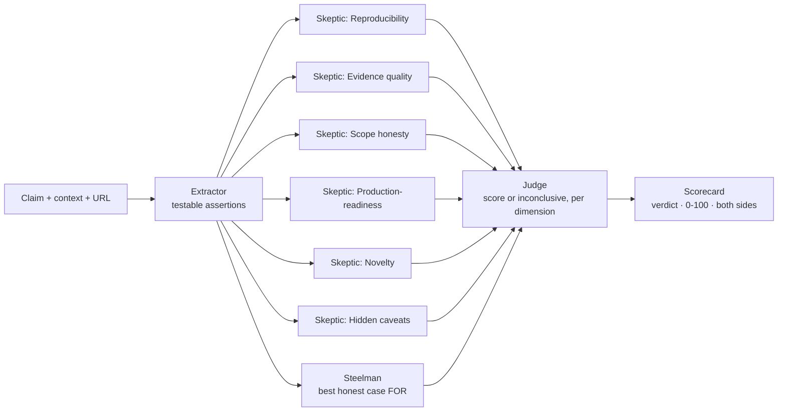

<div align="center">


</div>

<!-- sot:readme-pitch:start -->
# Saw an AI claim that sounds too good to be true?

Paste in an AI claim you saw online and get a straight answer, with evidence: real (SHIPS), half-true (MIXED) or hype (THEATER).

- Reading a launch post? Find out what actually shipped.
- Vetting a vendor demo? See what the evidence supports.
- Checking a headline before you share it? Get the reasons first.
<!-- sot:readme-pitch:end -->

<div align="center">

**Is it shipping, or is it theater?** Six skeptics, a steelman and a judge score any AI claim from 0 to 100 on a fixed, public rubric, and say *inconclusive* when the evidence can't support a number.

[](https://github.com/jordnlvr/ship-or-theater/actions/workflows/ci.yml)
[](https://www.npmjs.com/package/ship-or-theater)
[](LICENSE)
[](package.json)

[**Website**](https://jordnlvr.github.io/ship-or-theater/) · [**Gallery of real runs**](gallery/README.md) · [Quickstart](#quickstart) · [MCP](#mcp-server) · [Library](#library)

<!-- HERO SLOT: assets/hero.svg is generated by `node scripts/build-site.mjs` from the featured gallery run
     (gallery/*.json with "featured": true, else the highest score). Until a real run is published it shows the
     scorecard layout with weights only and no scores. Never hand-edit it. -->


</div>

## Quickstart

Node 20 or newer. Nothing to install.

```bash
# 1. See the rubric. No key, no login, no setup.
npx ship-or-theater rubric

# 2. Score a claim. Uses your Claude Code login, or ANTHROPIC_API_KEY if it is set.
npx ship-or-theater "Our 7B model beats GPT-4 on internal benchmarks." \
  --context "Launch post; no weights or eval suite released."
```

No API key? If [Claude Code](https://claude.com/claude-code) is installed and signed in, every agent call runs through your local `claude` CLI on your subscription. No key, no extra bill.

## Why

AI announcements are easy to make and hard to check. A polished demo, one cherry-picked benchmark or a rebranded wrapper can look exactly like shipped capability. ship-or-theater does the checking the same way every time: it argues both sides, scores six fixed dimensions, and shows its work.

The tool is built to the bar it judges: schema-validated structured output, adversarial verification, graceful degradation and no invented confidence.

## How it works



1. The **extractor** pulls the discrete, testable assertions out of the claim.
2. Six **skeptics**, one per dimension, run in parallel and hunt for theater.
3. The **steelman** argues the strongest *defensible* case for the claim, without inventing evidence.
4. The **judge** weighs skeptics against the steelman and gives each dimension a score, a confidence and its reasoning, or marks it `inconclusive`.
5. The **scorecard** takes the weighted mean of the usable dimensions and maps it to a verdict.

The skeptic panel runs under `Promise.allSettled`: if one fails, its dimension is `inconclusive` and drops out of the mean. The run never crashes and never fills the gap with a guess.

## The rubric

The rubric is the tool's point of view: fixed, weighted and published. Print it any time with `npx ship-or-theater rubric`.

| # | Dimension | Weight | The question |
|---|-----------|-------:|--------------|
| 1 | Reproducibility | 20% | Could an independent party reproduce it, or is it a cherry-picked demo? |
| 2 | Evidence quality | 20% | Real benchmarks and data, or screenshots and vibes? |
| 3 | Scope honesty | 20% | Does it generalize, or is narrow work dressed up as general? |
| 4 | Production-readiness | 15% | Demo or deployable: latency, cost, reliability, governance? |
| 5 | Novelty | 10% | Genuine new capability, or a wrapper and a rebrand? |
| 6 | Hidden caveats | 15% | What is not said: failure modes, constraints, cost? |

Each dimension scores 0 (pure theater) to 100 (real).

| Verdict | Reality score |
|---------|---------------|
| **SHIPS** | 70 and up |
| **MIXED** | 40 to 69 |
| **THEATER** | under 40 |
| **INCONCLUSIVE** | no usable dimension, so no score |

**Scoring.** Inconclusive dimensions are dropped and the remaining weights are renormalized, so the score stays on a 0-100 scale. If every dimension is inconclusive, the score is `null` and the verdict is `INCONCLUSIVE`. The tool refuses to assert a verdict it cannot support.

## CLI

```bash
npx ship-or-theater "<claim>" [options]
npx ship-or-theater rubric
npx ship-or-theater --version
```

| Flag | What it does |
|------|--------------|
| `-c, --context <text>` | Context around the claim (what was released, what wasn't) |
| `-u, --url <url>` | Source URL for the claim |
| `-f, --format <f>` | `pretty` (terminal view, the default on a TTY), `markdown` or `json` |
| `-j, --json` | Shorthand for `--format json` |
| `--no-color` | Plain output; `NO_COLOR=1` does the same |
| `-o, --out <file>` | Write the scorecard to a file instead of stdout |
| `-m, --model <model>` | Model override. Default `claude-sonnet-5-5`, or set `SOT_MODEL` |
| `--provider <p>` | `auto` (default: the API when `ANTHROPIC_API_KEY` is set, else Claude Code), `api` or `claude-cli` |
| `-V, --version` | Print the version |

```bash
# JSON for a pipeline
npx ship-or-theater "<claim>" --format json --out scorecard.json

# Markdown for a doc or a PR comment
npx ship-or-theater "<claim>" --format markdown > scorecard.md
```

## MCP server

`ship-or-theater-mcp` is a stdio MCP server with two tools:

- **`evaluate_claim`** runs the full pipeline and returns the scorecard (Markdown or JSON, plus structured content).
- **`get_rubric`** returns the rubric and verdict bands. Needs no model.

Add it to Claude Desktop or any MCP client:

```json
{
  "mcpServers": {
    "ship-or-theater": {
      "command": "npx",
      "args": ["-y", "--package", "ship-or-theater", "ship-or-theater-mcp"],
      "env": { "SOT_PROVIDER": "auto" }
    }
  }
}
```

`SOT_PROVIDER` is `auto` (default), `api` or `claude-cli`. With Claude Code installed no key is needed; for `api`, add `"ANTHROPIC_API_KEY": "sk-ant-..."` to `env`.

## Library

The pipeline takes an injected `llm` function, so it embeds anywhere and tests run against a fake with no network.

```ts
import { evaluate, createLLM, renderMarkdown } from "ship-or-theater";

const llm = createLLM({ apiKey: process.env.ANTHROPIC_API_KEY });
const scorecard = await evaluate(llm, {
  claim: "Our 7B model beats GPT-4 on internal benchmarks.",
  context: "Launch post; no eval suite released.",
});

console.log(scorecard.verdict, scorecard.overallScore);
console.log(renderMarkdown(scorecard));
```

## Gallery

[`gallery/`](gallery/README.md) holds saved runs of the tool on famous public AI claims, each dated and signed with the model that judged it. Nobody edits the scores. The [website](https://jordnlvr.github.io/ship-or-theater/) renders the same files.

<!-- sot:readme-gallery:start -->
| Claim | Claimant | Verdict | Score |
| --- | --- | --- | ---: |
| [AlphaFold 2 at CASP14](gallery/alphafold2-casp14.md) | Google DeepMind | MIXED | 65.8 |
| [Segment Anything's zero-shot transfer](gallery/segment-anything-zero-shot.md) | Meta | MIXED | 60.6 |
| [Whisper's speech recognition release](gallery/whisper-open-speech-recognition.md) | OpenAI | MIXED | 53 |
| [GPT-4's top-decile bar exam claim](gallery/gpt4-bar-exam-percentile.md) | OpenAI | MIXED | 46.1 |
| [Galactica's scientific knowledge claim](gallery/galactica-scientific-knowledge.md) | Meta | THEATER | 38.6 |
| [Devin's SWE-bench launch result](gallery/devin-swe-bench-launch.md) | Cognition | THEATER | 33.6 |
| [Gemini's 2023 multimodal demo](gallery/gemini-2023-multimodal-demo.md) | Google | THEATER | 30.9 |
| [Recall's launch privacy promise](gallery/recall-launch-privacy.md) | Microsoft | THEATER | 29.8 |

All 8 runs were made on Nov 7, 2026 with the `claude-cli` provider (the local `claude` CLI) and the model alias `sonnet`. None reached SHIPS, which takes 70 or more.
<!-- sot:readme-gallery:end -->

## Design principles: honest by construction

- **Inconclusive beats invented.** A dimension with no usable evidence gets no score. Nothing usable at all means no verdict.
- **The LLM layer is isolated.** Only the provider modules talk to a model. Every agent depends on an injected `llm`, so the whole system runs deterministically against a fake in tests.
- **Structured output, validated.** Each agent must return one tool call whose schema comes from zod, then passes `zod.parse`. One retry on a schema failure, then it throws; unvalidated data never moves on.
- **Prompt caching.** The shared rubric and persona block is sent with `cache_control: ephemeral`, so repeated agent calls in a run hit the cache.
- **Graceful degradation.** A failed skeptic makes its dimension inconclusive, not a crash and not a guess.
- **Pure, tested core.** Rubric math and rendering are pure functions with tests that assert computed numbers and band boundaries.

## Roadmap

- Source-URL fetching and citation extraction feeding the extractor.
- Calibration against a labelled corpus of past claims (known ships, known theater).
- Re-run history: re-evaluate a claim as new evidence lands.
- More model providers behind the `llm` interface.

## Development

```bash
npm install
npm run typecheck   # tsc --noEmit
npm test            # vitest, no API key needed
npm run build       # tsup -> dist/
```

Live smoke test against the real API: `npm run build && ANTHROPIC_API_KEY=... npm run smoke`. It runs one real evaluation and prints the scorecard.

The website lives in `site/`. After adding a run to `gallery/`, rebuild its data, the README hero image and the README gallery table with `node scripts/build-site.mjs`.

## License

MIT © [Kelly Seale](https://github.com/jordnlvr)
